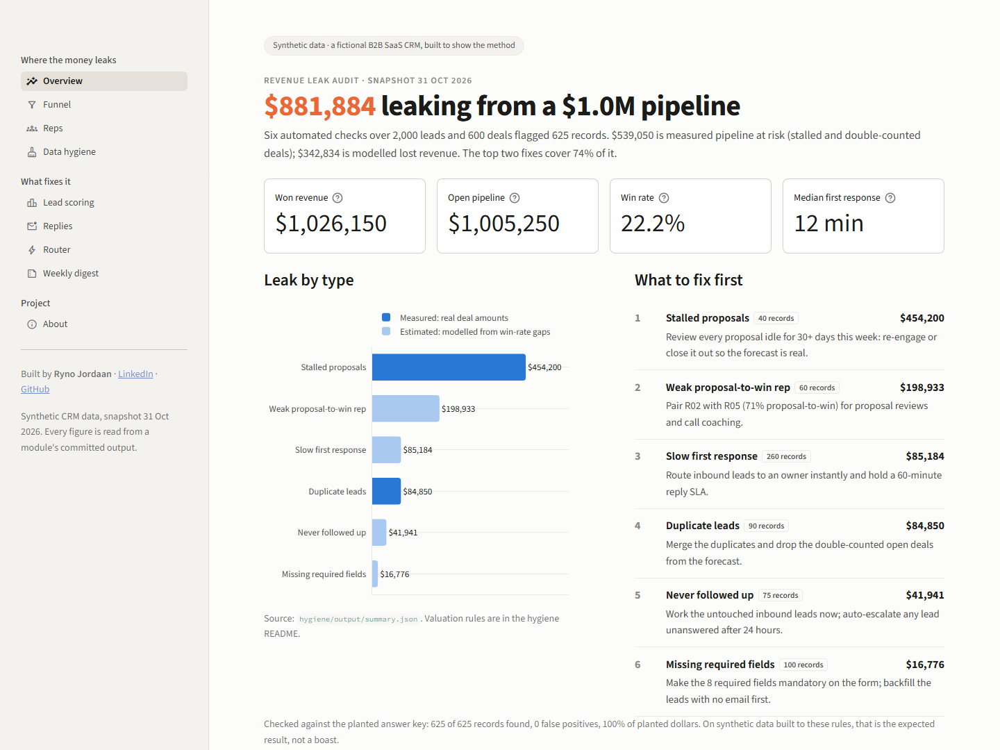
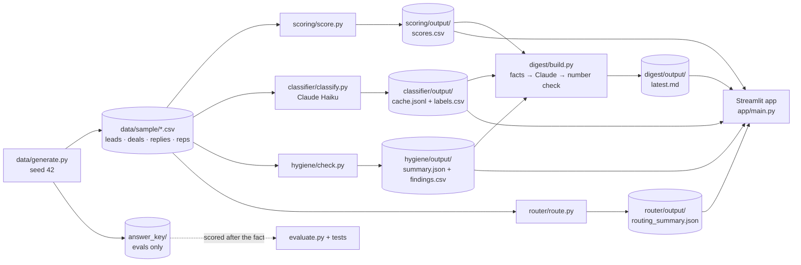

# Revenue Leak Engine

Finds where revenue leaks out of a sales pipeline, and what to fix first.

**$881,884 leaking from a $1.0M pipeline, found by six automated checks over 2,000 leads and 600 deals.**

[Live dashboard](https://revenue-leak-engine-yh3ipqcltain2zvnralelv.streamlit.app/) · Loom walkthrough (coming soon) · Case study (coming soon)
<!-- LOOM_URL: replace "Loom walkthrough (coming soon)" with [Loom walkthrough](LOOM_URL) -->
<!-- CASE_STUDY_URL: replace "Case study (coming soon)" with [Case study](CASE_STUDY_URL) -->



> **Synthetic data only.** Every company, person, email and deal is generated by
> `data/generate.py` (seed 42, snapshot 2026-10-31) for a fictional B2B SaaS company. Amounts are
> in USD. No real customer or CRM data is used.

## What's inside

| Module | What it does | Headline number |
|---|---|---|
| [`scoring/`](scoring/README.md) | Scores every lead 0–100 with tier A–D and plain-English reasons | On leads the model never saw, A-tier won at **3.8x** the D-tier rate (10.9% vs 2.9%). Test AUC **0.61**: a weak signal, and the README says so |
| [`classifier/`](classifier/README.md) | Claude Haiku sorts sales-email replies into five buckets | **99.6%** accuracy on **1,500** replies (6 wrong), **USD 0.14** for the whole run |
| [`hygiene/`](hygiene/README.md) | Six CRM checks: stalled proposals, weak rep, slow response, duplicates, never followed up, missing fields | **625 of 625** planted records found, **0** false positives |
| [`router/`](router/README.md) | Speed-to-lead: validate, dedupe, enrich, score, assign, alert | Lead to owner in **8 ms** (median) vs a **13-minute** median wait for a first reply |
| [`digest/`](digest/README.md) | A 250-word Monday brief for a sales leader, written by Claude | Every number checked against computed facts before it's published, about **USD 0.01** a run |
| [`app/`](app/README.md) | Streamlit dashboard over all of the above | **9** pages, no API calls, no secrets |

Data model and the leak answer key: [`docs/SCHEMA.md`](docs/SCHEMA.md).

## Architecture



The two LLM steps (classifier, digest) write their results to committed files. The dashboard only
reads files, so it needs no API key and makes no API calls.

## Decisions worth asking me about

- **The answer key is kept out of every detector.** The generator plants six leaks and writes
  the answer key to `data/sample/answer_key/`. No detector reads it: `hygiene/check.py`,
  `scoring/score.py` and `router/route.py` work from the CRM export only, and the classifier drops
  `true_label` before any row is used. Only `evaluate.py` files and the tests open the key, and only
  to score results afterwards.
- **LLM results are cached, so the live demo costs $0.** Classifier results go to
  `classifier/output/cache.jsonl`, keyed by reply and a hash of the model, prompt and schema. A rerun
  with the same prompt is free. The dashboard reads `labels.csv` and `digest/output/latest.md` and
  never calls the API.
- **The digest's number check.** Python computes every fact; Claude only writes the sentences. A
  checker then pulls every number out of the brief and looks it up in `facts.json`. `$454k` passes
  for 454,200; `$455k` fails. If a number isn't there, Claude gets one retry, then the script exits
  and nothing is published. The committed brief passed with 40 of 40 numbers and dates found.
- **Time-split validation in scoring.** The model trains on leads created before 2026-06-01 and is
  tested once on June–August leads. Features are measured as a rep would see them, so later replies
  can't leak the outcome. Forward selection kept two inputs (region, response speed). Forcing all
  nine in scored a test AUC of 0.54, worse than the two-input model.
- **Synthetic data, because of privacy law.** A real CRM export is full of personal data
  (names, emails, companies) that privacy law doesn't let me publish. A seeded generator gives
  data anyone can rebuild byte for byte, with leaks planted at known counts, so every module can be
  scored against an answer key.

## What broke and how I fixed it

- **Regenerated data wasn't byte-identical on Windows.** Rebuilding the sample on Windows wrote
  `leak_summary.json` with CRLF line endings, so the "rebuild byte for byte" promise broke. The CSVs
  were already written with `lineterminator="\n"`, but the JSON went through `write_text`, which
  uses the OS line ending. Fix (commit `8ae81fe`): pass `newline="\n"` there too.
- **The never-followed-up check found 74 of 75.** I measured lead age in elapsed hours, so a lead
  created 6.25 days before the snapshot fell short of 7 days. `docs/SCHEMA.md` counts calendar days,
  so I changed the check to match. The fix came from reading the definition, not from tuning to the
  key.
- **Name similarity alone merged different businesses.** In the router's dedupe, a company-name
  match at ratio ≥ 0.9 produced 19 false pairs, such as "Riverlight Clinic" and "Silverlight Clinic
  Co.". A fuzzy match now also needs a second signal (the same contact surname or the same business
  email domain). Result: 90 of 90 planted duplicates matched, 0 false matches among 1,910 original
  leads.

## Honest limits

- **Synthetic data flatters the hygiene and classifier numbers.** The planted leaks follow the same
  rules the checks encode, so 625 of 625 is an upper bound. The 1,500 replies come from about 300
  distinct sentences; real email is longer and messier, so expect the 99.6% to drop.
- **Scoring is a weak signal.** 42 test wins is a small sample, and the AUC interval (0.52–0.69)
  nearly touches 0.5. The steadier comparison is the top two tiers against the bottom two: 8.6% vs
  3.4%, or 2.5x. Treat tiers as a rough ordering, not a forecast.
- **The router doesn't reply for you.** 8 ms is the time to get a lead to an owner, not a response
  time. A person still has to reply. Enrichment is a stub, and nothing is written back to a CRM.
- **Some dollar figures are estimates.** $539K of the leak is measured deal value (stalled and
  double-counted deals). The rest is modelled from win-rate gaps, which show correlation, not cause.

Each module README has the full list.

## Run it locally

From the repo root:

```bash
python -m venv .venv
```

```bash
.venv/Scripts/pip install -r requirements.txt   # macOS/Linux: .venv/bin/pip
```

Then, with the venv active, in this order:

```bash
python data/generate.py          # rebuild data/sample/ (seed 42)
python scoring/score.py
python hygiene/check.py
python router/demo.py
python classifier/classify.py    # needs ANTHROPIC_API_KEY; cached replies are free
python digest/build.py           # needs ANTHROPIC_API_KEY; --dry-run needs none
streamlit run app/main.py
```

`.env` is only needed for the classifier and the digest. Copy `.env.example` to `.env` and add
`ANTHROPIC_API_KEY`. All module outputs are committed, so `streamlit run app/main.py` works on a
fresh clone without running anything else.

## About

Built by Ryno Jordaan, GTM engineer.
[LinkedIn](https://www.linkedin.com/in/ryno-jordaan/) · [GitHub](https://github.com/RynoJor)

The live dashboard runs on Streamlit Community Cloud's free tier. If it has been idle it may be
asleep: click the wake-up button and give it a minute.

MIT licence. See [`LICENSE`](LICENSE).
