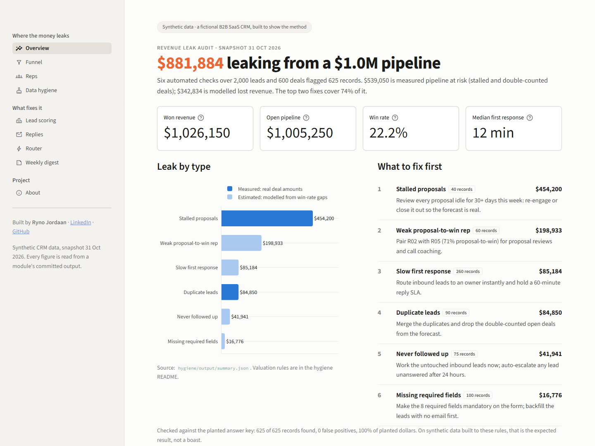

# app/: the leak dashboard

A Streamlit app that shows where revenue leaks out of the pipeline, what each leak is worth, and
what the other modules do about it.



**It makes no API calls and needs no secrets.** Every number is read from a file another module
has already written and committed, so the dashboard costs nothing per visit and runs on Streamlit
Community Cloud as-is. The headline figure comes from `hygiene/output/summary.json`; nothing is
hard-coded.

## Run it

From the repo root, with the project `.venv` (only the packages in `requirements.txt`):

```bash
streamlit run app/main.py
```

## Pages

| Page | What it shows | Reads |
|---|---|---|
| Overview | Total leak vs open pipeline, KPI tiles, leak $ by type (measured vs estimated), what to fix first | `hygiene/output/summary.json`, `evaluation.json`, `data/sample/` |
| Funnel | Stage reach and conversion of decided deals, losses by stage and reason, days in stage, stalled proposals | `deals.csv`, `deal_stage_history.csv`, `hygiene/output/findings.csv` |
| Reps | Proposal→won by rep with the flagged outlier, slow vs fast reply win rate, rep scorecard | `hygiene/output/summary.json`, `leads.csv`, `deals.csv` |
| Data hygiene | Records and $ per check, precision/recall vs the key, filterable findings with CSV download | `hygiene/output/` |
| Lead scoring | Held-out win rate by tier, the AUC caveat, points table, filterable scored leads with reasons | `scoring/output/` |
| Replies | Label mix, accuracy and API cost, the interested-replies queue (low-confidence flagged) | `classifier/output/`, `replies.csv` (without `true_label`) |
| Router | Routing ms vs historical first-response minutes, per-stage timing, replay log | `router/output/` |
| Weekly digest | Renders `digest/output/latest.md`, or says it isn't generated yet | `digest/output/latest.md` |
| About | Architecture diagram, the synthetic-data note, links to every module README | — |

## Code

- `main.py`: page config, navigation, the synthetic-data banner.
- `loaders.py`: one `st.cache_data` loader per file, plus two small derived views (pipeline KPIs,
  time in stage). `replies.csv` is loaded without `true_label`.
- `ui.py`: the colour roles (one accent, one highlight for "look here", one neutral), number
  formats, the page header and the shared Plotly layout.
- `views/`: one module per page, each with a `render()` function.

Theme: `.streamlit/config.toml` (light, one accent).

## Choices worth knowing

- **Measured vs estimated dollars are shown apart.** $539K of the leak is real deal value (stalled
  and double-counted deals); the rest is modelled from win-rate gaps. The Overview says so in the
  first paragraph.
- **Funnel conversion leaves open deals out.** Conversion is moved on ÷ (moved on + lost), so deals
  still sitting in a stage don't drag the rate down.
- **Caveats sit next to the numbers they qualify:** the AUC warning on Lead scoring, the template
  note on Replies, "a person still has to reply" on Router.
