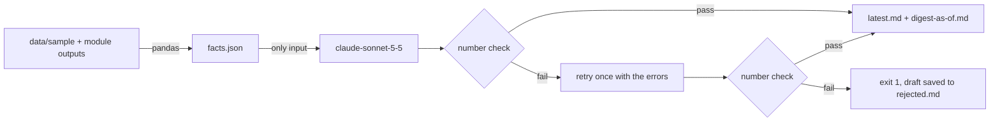

# digest/: weekly AI digest

**Turns the pipeline into a 250-word Monday brief for a sales leader. Every number in it is checked against the source data before it is published.**

Python computes the facts. Claude only writes the sentences. A checker then pulls every number out
of the text and looks it up in `facts.json`. If a number isn't there, the brief isn't published.
One run costs about **$0.01**.

All data is synthetic (see the repo README).

## Sample: week ending 2026-10-31

This is `output/latest.md` from the committed run, unedited. The dashboard shows the same file.

> **Summary**
> Money at risk is $882k across 625 records, and $454k of it sits in 40 proposals stalled 30+ days.
> 8 proposals crossed 30 days idle this week, worth $89k, up from 1 deal last week.
> Deals won fell to 1 this week from 7, and 89 interested replies are still waiting.
>
> **Top 3 actions (by $ at risk)**
> 1. Call every stalled proposal this week, oldest first (40 deals), $454k, Owner: each deal's rep; largest book is Danielle Johnson (R01, 11 deals, $114,500).
> 2. Coach R02 on proposal follow-through and review their open proposals, $199k, Owner: sales manager, with Robert Johnson (R05) as peer coach.
> 3. Enforce a 60-minute first-response SLA on inbound leads with an alert, $85k, Owner: RevOps (router alert) and the inbound reps.
>
> **Better / worse vs last week**
> - Worse: proposals crossing 30 days idle went from 1 to 8, and the dollars in them from $23,950 to $89,450.
> - Worse: new duplicate leads went from 2 to 10, and USD won went from $54,600 to $20,100.
> - Worse: inbound leads answered after 60 minutes went from 3 to 5.
> - Better: new deals opened rose from 13 to 19, and new interested replies still waiting fell from 6 to 5.
>
> **Risk**
> Joshua Walker (R02) converts 18% of proposals to won against 54% for the other reps, and 83 interested replies have waited over 7 days, so both stalled deals and weak follow-through will keep costing revenue.
>
> _Number check: 40 numbers and dates in the text, all found in facts.json._

## How it works



**1. Facts first, in Python.** `compute_facts()` reads `data/sample/*.csv` and the outputs of the
other modules (hygiene findings and summary, lead scores, classifier labels). "This week" is the 7
days up to the latest date in the data (2026-10-25 to 2026-10-31), compared with the 7 days before.
It covers:

| Fact | Definition |
|---|---|
| Stalled proposals that crossed 30 days | open `proposal` deal whose last activity + 30 days falls in the week |
| Slow responses | inbound leads created in the week with a first response after 60 minutes |
| New duplicates | duplicate leads (from `hygiene/output/findings.csv`) created in the week |
| Leads left untouched | never-followed-up leads whose 7-day mark falls in the week |
| $ at risk | the six leaks from `hygiene/output/summary.json` ($881,884 in total) |
| Interested replies waiting | open lead (`contacted` / `nurturing`, no deal) whose latest reply the classifier labelled `interested` |
| A-tier leads not contacted | tier A in `scoring/output/scores.csv` and no first response (0 this week; see Limits) |
| Rep outlier | the rep the hygiene check flags on proposal-to-won rate (R02, z = -4.76) |

Python also does the arithmetic the model is not allowed to do: week-over-week changes, the
better/worse direction of each, percentages, and the list of actions **ranked by $ with an owner**.
The model picks the top three from that list in order.

**2. Only facts go to Claude.** The request holds the system prompt and `facts.json`, nothing
else: no CSV rows, no contact details beyond rep names. The exact prompt is saved to
`output/prompt.md` on every run. Model: `claude-sonnet-5-5` at medium effort, through the
`anthropic` SDK, key read from `.env` by `python-dotenv` and never printed. Server-side
refusal fallback is on (`fallbacks="default"`), so a declined request is re-run on another model,
and the footer names whichever model actually wrote the text.

**3. The number check.** `check_digest()` in `build.py`, tested in `tests/test_check.py`:

1. Collect every number in `facts.json`: numeric values, plus numbers written inside strings
   (such as `$114,500` in an owner line) and the parts of each date.
2. Find every number in the brief with a regex: `$` and thousands commas allowed, decimals, and a
   `k`, `M` or `%` suffix. IDs such as `R02` or `D0589` are skipped because a letter comes first;
   `1.` `2.` `3.` list markers are layout, so they are skipped too. Dates must match a date in
   facts.json exactly. Number words (`twenty`, `half`, `doubled`) are checked too.
3. A number passes only if some fact, formatted the same way, produces it: rounded to the same
   decimal places and scale. `454200` may appear as `454,200`, `$454k`, `$454.2k` or `$0.5M`,
   but `$455k` fails. A `%` may sit on a fact already in percent or on a 0-1 rate (`0.1833` →
   `18%`). A minus sign may be dropped ("down 3").
4. The same pass enforces the style rules: at most 250 words, no hype words, no exclamation marks.
5. If anything fails, the errors and the draft go back to Claude once ("number '37%' is not in
   facts.json"). If the second draft also fails, the script exits with code 1, nothing is
   published, and the draft is saved to `output/rejected.md`.

`output/run.json` records each attempt, what was checked, tokens and cost.

What the check can't catch: a real number attached to the wrong claim (for example, the R01 count
reported as R02's). Small integers such as 1 to 10 appear many times in the facts, so they are
weakly checked. It proves every number came from the data, not that every sentence is correct;
a person still reads the brief before Monday's meeting.

## Cost

The committed run: 3,056 input and 553 output tokens on `claude-sonnet-5-5` ($2 / $10 per million
tokens) = **$0.0116**, one attempt. A retry roughly doubles that. 52 Mondays a year is about $0.60.

## Run it

From the repo root, with the project `.venv`:

```bash
python digest/build.py --dry-run
```

Writes `output/facts.json` and `output/prompt.md` and stops. No API key needed.

```bash
python digest/build.py
```

Full run: facts, Claude, check. Writes `output/latest.md` (the dashboard reads this exact path) and
`output/digest-<as-of>.md`, plus `run.json`. Needs `ANTHROPIC_API_KEY` in `.env`.

```bash
python digest/build.py --slack
```

Also posts the brief to `SLACK_WEBHOOK_URL` from `.env` (an incoming-webhook URL). If it isn't set,
the flag prints a note and skips.

```bash
python -m pytest digest/tests -q
```

Tests the number check with no API calls.

The live dashboard never calls the API: it renders the committed `latest.md`.

## Schedule it (examples, not enabled)

The sample data is a fixed snapshot, so nothing is scheduled. Against a live CRM export it would run
early on Monday.

cron (07:00 every Monday):

```cron
0 7 * * 1  cd /srv/revenue-leak-engine && .venv/bin/python digest/build.py --slack >> digest/cron.log 2>&1
```

GitHub Action (save as `.github/workflows/digest.yml` to enable; secrets set in the repo settings):

```yaml
name: weekly-digest
on:
  schedule:
    - cron: "0 7 * * 1"   # Mondays 07:00 UTC
  workflow_dispatch:
jobs:
  digest:
    runs-on: ubuntu-latest
    steps:
      - uses: actions/checkout@v4
      - uses: actions/setup-python@v5
        with:
          python-version: "3.12"
      - run: pip install -r requirements.txt
      - run: python digest/build.py --slack
        env:
          ANTHROPIC_API_KEY: ${{ secrets.ANTHROPIC_API_KEY }}
          SLACK_WEBHOOK_URL: ${{ secrets.SLACK_WEBHOOK_URL }}
      - uses: actions/upload-artifact@v4
        with:
          name: digest
          path: digest/output/
```

A failed number check fails the job, so a bad brief never reaches Slack.

## Limits

- **"A-tier leads not contacted" is 0.** The lead score uses first-response speed as an input,
  so a lead nobody answered can't reach tier A. The brief uses A-tier leads with an interested
  reply waiting (16) instead. See `scoring/README.md`.
- **"Waiting" is inferred.** There is no activity log for replies, so an interested reply counts as
  waiting while the lead is still open with no deal.
- **One week of synthetic data.** The week-over-week changes are small counts (1 vs 7 deals won)
  and say little on their own.
- **Not deterministic.** Rerunning gives different wording. `facts.json` is byte-identical on rerun;
  the brief is not.

## Files

| File | What |
|---|---|
| `build.py` | facts, prompt, Claude call, number check, outputs, `--dry-run`, `--slack` |
| `tests/test_check.py` | number-check tests, no API |
| `output/facts.json` | every number the brief may use |
| `output/prompt.md` | the exact system and user prompt sent |
| `output/latest.md` | the current brief (read by the dashboard) |
| `output/digest-2026-10-31.md` | dated copy |
| `output/run.json` | tokens, cost, check results per attempt |
