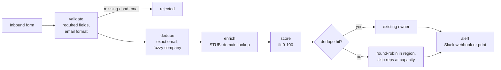

# router/: speed-to-lead router

**In the last 50 inbound leads, the median wait for a first reply was 13 minutes. 9 of the 48 that got a reply waited more than an hour, and 2 never got one. The router assigns an owner and alerts them in about 8 ms (median of the committed run; timing varies by machine).**

Why it matters: in this data, inbound leads answered within an hour win 25% of closed deals, and
slow ones win 10% (see the slow-first-response leak in [`docs/SCHEMA.md`](../docs/SCHEMA.md)).

What the router does and doesn't do: it removes the time spent working out whose lead it is, and it
tells that rep straight away. **A person still has to reply.** 8 ms is the time to get the lead to
an owner, not a response time, and nothing here proves reps would answer faster. The router takes
away the routing delay, so any delay left is the rep's.

All data is synthetic (see the repo README).

## Pipeline

Every stage is timed with `time.perf_counter`.



| Stage | What it does |
|---|---|
| validate | Requires `company`, `contact_name`, `email`, `region`, `source`. A missing or malformed email rejects the lead (it cannot be worked). Any other gap is flagged and routing carries on |
| dedupe | **Exact email** (case-insensitive): same person, flagged `duplicate_contact`. **Company name**: known account, flagged `known_account`. Names are normalised first (case, punctuation, legal suffixes, spaces), so "Lark Well Bakery, Inc." equals "Larkwell Bakery LLC". A *fuzzy* name match (difflib ≥ 0.85, so typos count) also needs a second signal: the same contact surname or the same business email domain. Public mail domains never count |
| enrich | **Stub.** Fills a missing `industry` from words in the email domain (`…physio.com` → Health & Wellness) and a missing `company_size` from a hash of the domain. Public mail domains are skipped and flagged |
| score | Fit score 0–100: source intent (demo request 35 … content download 10), company size, core industry, business email. **Placeholder** for `scoring/` |
| assign | A dedupe hit goes to the rep who already owns that person or account. Otherwise it is round-robin within the lead's region, skipping any rep whose open leads (status `new` or `contacted`) are at capacity (default 160). If the whole region is full, the lead goes to the least-loaded rep and is flagged `over_capacity`, so it is never left unowned. If the region is unknown, all reps are used and the lead is flagged `unknown_region` |
| alert | If `SLACK_WEBHOOK_URL` is set in `.env`, posts to that Slack incoming webhook. Otherwise prints the alert. The URL is never printed or logged, even when the post fails |

### Dedupe accuracy (checked against the answer key)

The tests run the dedupe over the whole sample:

- **90 of 90** planted duplicates (40 exact, 50 fuzzy) are matched to the right original.
- **0** false matches among the 1,910 original leads.

The second-signal rule is what makes the zero possible. With name similarity alone (ratio ≥ 0.9),
19 pairs of different businesses matched, such as "Riverlight Clinic" and "Silverlight Clinic Co.".
The router itself never reads `answer_key/`; only the tests do.

## Run it

From the repo root, using the project venv (`.venv/Scripts/python` on Windows,
`.venv/bin/python` on macOS/Linux):

```bash
python router/route.py          # route one example lead, print the route and the alert
python router/demo.py           # replay the 50 most recent inbound leads
python -m pytest router/tests   # 18 tests: assign, dedupe, validate (needs pytest)
```

`route.py --lead-json '{"company": ..., "email": ...}'` routes a lead you pass in.
`demo.py --alerts` sends each replayed alert (to Slack if the webhook is set). Without the flag,
the demo builds the alert text but doesn't send it, so `alert_ms` there is formatting time only.

To post to Slack, add a line `SLACK_WEBHOOK_URL=https://hooks.slack.com/...` to `.env`
(git-ignored). `python-dotenv` is in `requirements.txt` and loads it.

Example output:

```
L01930: validate 0.01 ms -> dedupe 0.00 ms -> enrich 0.01 ms -> score 0.00 ms -> assign 0.01 ms -> alert 0.00 ms
    Owner: R02 [existing owner (email match)] | score 60 | email:L00481 | flags: duplicate_contact
    Lead to owner in 0.04 ms
...
Historical median first response 13 minutes (9 of 48 waited over an hour, 2 never got a reply); routed in 8.0 ms (median, max 11.3 ms).
```

Most of the 8 ms is the fuzzy company search over ~1,900 names. An exact email hit returns before
that search runs.

### How the replay works

- It replays the 50 most recent inbound leads (by `created_at`), oldest first.
- It dedupes against every lead created before the first replayed lead. Each replayed lead is
  added to that pool once it has been routed.
- Rep load (open leads per rep) is counted from that same pool.
- The form is assumed to send only company, contact name, email, region and source. `industry` and
  `company_size` come from the enrich stub, not from the CRM.
- Of the 50: 49 routed, 1 rejected (no email), and 4 duplicates went to their existing owner.
  The lead that most recently hit capacity skipped R02, who has the heaviest open-lead load.
- Timings are wall-clock, so they move slightly from run to run.

### Output for the dashboard

`router/output/routing_log.csv`, one row per replayed lead:

| Column | Meaning |
|---|---|
| `lead_id` | Lead from `leads.csv` |
| `assigned_rep` | `rep_id` chosen by the router (empty if rejected) |
| `score` | Fit score 0–100 (empty if rejected) |
| `total_ms` | Sum of the stage times |
| `validate_ms` `dedupe_ms` `enrich_ms` `score_ms` `assign_ms` `alert_ms` | Per-stage time (empty for stages a rejected lead never reached) |
| `dedupe_hit` | `True` / `False` |
| `flags` | `;`-separated, e.g. `public_email_domain;duplicate_contact` |
| `status` | `routed` or `rejected` |
| `region` | Lead's region |
| `dedupe_match` | `email:L00481` or `company:L00956` |
| `assign_reason` | `round_robin`, `round_robin (skipped N at capacity)`, `existing owner (...)`, `least_loaded (...)` |
| `historical_owner_rep_id` | Who owned it in the CRM |
| `historical_first_response_minutes` | What actually happened (empty = never answered) |

`router/output/routing_summary.json` holds the headline numbers (`routing_ms_median`,
`historical_first_response_minutes_median`, `historical_over_60_min`, `dedupe_hits`, …).

## What's stubbed

- **Enrichment** (`enrich` in `route.py`). It is a keyword table and a hash, not a data provider.
  The industry guess agrees with the CRM for every lead with a business email, but only because the
  synthetic generator builds each domain from the company name. Real domains won't be that
  convenient. The size band is a hash, so it carries no real information. A real build would call
  Clearbit/Apollo-style enrichment here and cache the result by domain.
- **Fit score** (`fit_score`). A short rule set so the router doesn't depend on `scoring/`, which is
  still being built. In production, the score stage would call the scoring module.
- **Capacity** is a single number of open leads per rep. Real teams use working hours, time zones,
  out-of-office status and per-rep caps.
- **The CRM** is a CSV loaded into memory. Nothing is written back.

## What production would need

1. **A webhook from the form** (HubSpot/Typeform/Webflow form submission → an HTTPS endpoint), so
   routing starts the second the lead is created, not on a schedule.
2. **A queue** between the webhook and the router (SQS, Pub/Sub, a Redis stream), with retries and a
   dead-letter queue. A slow enrichment API or a Slack outage should then never drop a lead.
3. **A CRM write**: create or merge the lead, set the owner, and log the routing decision on the
   record (HubSpot/Salesforce API). The round-robin position and rep loads need shared storage, not
   process memory, so two workers can't assign the same slot.
4. **Real enrichment and scoring** calls with timeouts and a fallback, so routing never waits on
   them for long.
5. **Response tracking**: an SLA timer that escalates to a manager or reassigns the lead when the
   rep hasn't replied within N minutes. This is the part that changes the human response time.
6. **Secrets** (webhook URL, API keys) in a secret manager rather than `.env`.
